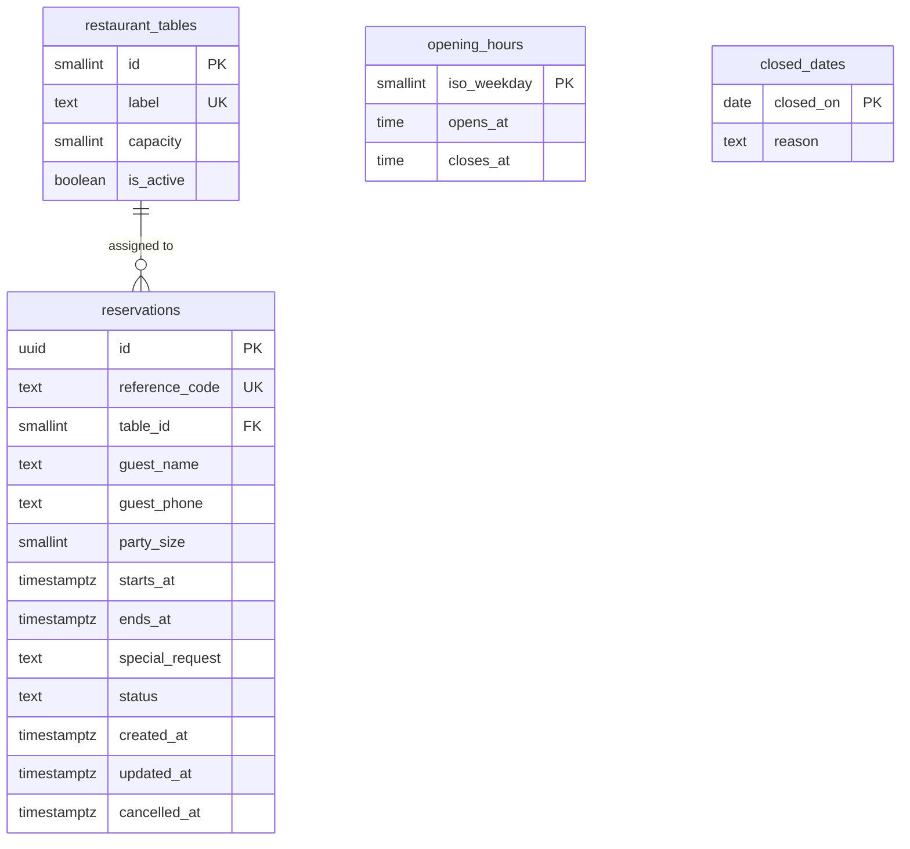

# Restaurant Reservation Service: Data Model

| | |
|---|---|
| **Author** | Hadil Trabelsi |
| **Database** | PostgreSQL |
| **Related** | [Requirements and invariants](requirements-and-invariants.md) · [API contracts](api-contracts.md) |

## 1. Overview

The model has four tables. Two describe when the restaurant is open, one describes the physical tables, and one stores reservations.



`opening_hours` and `closed_dates` are standalone. The service reads them to decide whether the restaurant is open on a given day.

## 2. Design decisions

| Decision | Reason |
|---|---|
| Times are stored as `timestamptz` (UTC). Opening hours are stored as local `time` values. | Reservations are exact instants. Opening hours are a daily pattern in the restaurant's time zone (Africa/Tunis). |
| `ends_at` is stored next to `starts_at`. | The overlap constraint needs the full time range. A check keeps it equal to start plus 90 minutes. |
| A closed weekday has no row in `opening_hours`. | One rule for "closed": no row means closed. |
| `status` is `text` with a check, not a PostgreSQL enum. | Adding a status later is a simple migration. |
| Cancelled reservations stay in the table. | Keeps history and avoids deletes. The overlap constraint ignores them. |
| The reference code is separate from the internal `id`. | Guests see a short readable code. The `uuid` stays internal. |
| Rule parameters (slot interval, duration, party limit, booking window) live in application settings. | They are not data. Only `opening_hours` and `closed_dates` are in the database because staff will change them over time. |
| The overlap rule is a database constraint. | The service can contain a race condition. The database cannot. |

## 3. Schema

```sql
CREATE EXTENSION IF NOT EXISTS btree_gist;

CREATE TABLE restaurant_tables (
    id         smallint GENERATED ALWAYS AS IDENTITY PRIMARY KEY,
    label      text     NOT NULL UNIQUE,
    capacity   smallint NOT NULL CHECK (capacity BETWEEN 1 AND 6),
    is_active  boolean  NOT NULL DEFAULT true
);

CREATE TABLE opening_hours (
    iso_weekday smallint PRIMARY KEY CHECK (iso_weekday BETWEEN 1 AND 7),  -- 1 = Monday
    opens_at    time NOT NULL,
    closes_at   time NOT NULL,
    CHECK (opens_at < closes_at)
);

CREATE TABLE closed_dates (
    closed_on date PRIMARY KEY,
    reason    text
);

CREATE TABLE reservations (
    id              uuid        PRIMARY KEY DEFAULT gen_random_uuid(),
    reference_code  text        NOT NULL UNIQUE
                                CHECK (reference_code ~ '^RSV-[A-HJ-NP-Z2-9]{6}$'),
    table_id        smallint    NOT NULL REFERENCES restaurant_tables (id),
    guest_name      text        NOT NULL CHECK (char_length(guest_name) BETWEEN 2 AND 80),
    guest_phone     text        NOT NULL CHECK (guest_phone ~ '^\+[1-9][0-9]{7,14}$'),
    party_size      smallint    NOT NULL CHECK (party_size BETWEEN 1 AND 6),
    starts_at       timestamptz NOT NULL,
    ends_at         timestamptz NOT NULL,
    special_request text        CHECK (char_length(special_request) <= 200),
    status          text        NOT NULL DEFAULT 'confirmed'
                                CHECK (status IN ('confirmed', 'cancelled')),
    created_at      timestamptz NOT NULL DEFAULT now(),
    updated_at      timestamptz NOT NULL DEFAULT now(),
    cancelled_at    timestamptz,

    CHECK (ends_at = starts_at + interval '90 minutes'),
    CHECK ((status = 'cancelled') = (cancelled_at IS NOT NULL)),

    -- INV-01: no overlapping confirmed reservations on the same table
    EXCLUDE USING gist (
        table_id WITH =,
        tstzrange(starts_at, ends_at) WITH &&
    ) WHERE (status = 'confirmed')
);

CREATE INDEX reservations_starts_at_idx ON reservations (starts_at);
```

The reference code is generated by the service: `RSV-` followed by six characters from `A-Z` and `2-9`, without `I` and `O` to avoid confusion with `1` and `0`.

## 4. Seed data

Synthetic data for development and tests.

| Table | Content |
|---|---|
| `restaurant_tables` | `T01`–`T04` capacity 2, `T05`–`T08` capacity 4, `T09`–`T10` capacity 6 |
| `opening_hours` | `iso_weekday` 2 to 7 (Tuesday to Sunday), 12:00–23:00. No row for Monday. |
| `closed_dates` | A small set of future dates for tests |
| `reservations` | A few confirmed and cancelled rows, including adjacent and overlapping cases |

## 5. Where each invariant is enforced

| Invariant | Database | Service |
|---|---|---|
| INV-01 No overlap on a table | `EXCLUDE` constraint | Maps the violation to `SLOT_UNAVAILABLE` |
| INV-02 Opening hours and slot grid | | Checks against `opening_hours` and settings |
| INV-03 Closed days | | Checks `closed_dates` and `opening_hours` |
| INV-04 Party size and table fit | `CHECK` on range 1–6 | Chooses a table with `capacity >= party_size` |
| INV-05 Booking window | | Checks against the current time |
| INV-06 Valid data | `NOT NULL` and `CHECK` constraints | Validates before writing |
| INV-07 Unique reference code | `UNIQUE` | Retries with a new code on collision |
| INV-08 Cancelled never blocks, never reactivated | Constraint applies to `confirmed` only | No reactivation operation |
| INV-09 Atomic changes | Transactions | One transaction per operation |
| INV-13 No hard delete | | No delete operation |

INV-10 (duplicate requests) and INV-11 (ownership) are service-level rules and are not part of the schema in Phase 1. If duplicate handling needs storage, it is added in Phase 2.

## 6. Availability logic

A slot starting at `S` is available for a party of `N` when all of these hold:

1. The restaurant is open on that date and `S` is on the 30-minute grid, no later than the last start time.
2. `S` is inside the booking window.
3. At least one active table has `capacity >= N` and no confirmed reservation overlapping `[S, S + 90 minutes)`.

```sql
SELECT t.id
FROM restaurant_tables t
WHERE t.is_active
  AND t.capacity >= :party_size
  AND NOT EXISTS (
        SELECT 1
        FROM reservations r
        WHERE r.table_id = t.id
          AND r.status = 'confirmed'
          AND tstzrange(r.starts_at, r.ends_at) && tstzrange(:slot_start, :slot_start + interval '90 minutes')
  )
ORDER BY t.capacity, t.id
LIMIT 1;
```

The same query picks the table on creation, smallest capacity first.

## 7. Concurrency

Two guests can ask for the last free table at the same moment. Both may see it as free. The exclusion constraint makes the second insert fail. The service catches that error (SQLSTATE `23P01`), tries the next fitting table once, and returns `SLOT_UNAVAILABLE` if none is left. No double booking is possible, whatever the order of the requests.
