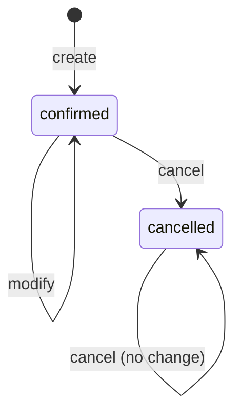

# Restaurant Reservation Service: Requirements and Invariants

| | |
|---|---|
| **Author** | Hadil Trabelsi |
| **Related** | [Data model](data-model.md) · [API contracts](api-contracts.md) |
| **Data** | Synthetic restaurant. No real customer data. |

## 1. Purpose and scope

This document defines who uses the restaurant system, what they can do, and which rules must always hold. The data model and the API contracts are derived from it.

The business service and its database are the single source of truth for availability and reservation state. The manual web app and, later, the AI agent are clients of that service. They never decide whether a table is free or a reservation exists.

| In scope | Out of scope |
|---|---|
| One restaurant, one time zone | Several restaurants or branches |
| Check availability, create, view, modify, cancel reservations | Payments, deposits, no-show handling |
| Guest and staff access | Walk-ins, waiting list, combining tables |
| Fixed rules for hours, slots, party size | Managing tables and hours through the API (seeded data only) |

## 2. Users and roles

| Role | Description | Identified by |
|---|---|---|
| Guest | A customer booking through the web app, by phone, or through the agent | Reference code and the phone number used at booking |
| Staff | Restaurant employee | Staff credentials (bearer token) |
| Agent | The AI assistant. It acts for a guest, using only the tools it is given. It has no direct database access. | Same as the guest it acts for |


## 3. Actions and permissions

| Action | Guest / Agent | Staff |
|---|:-:|:-:|
| Read opening hours and booking rules | Yes | Yes |
| Check availability for a date and party size | Yes | Yes |
| Create a reservation | Yes | Yes |
| View a reservation | Own only | Any |
| Modify a reservation | Own only | Any |
| Cancel a reservation | Own only | Any |
| List all reservations for a date | No | Yes |

## 4. Business parameters

These values are assumptions for the sandbox. They live in application settings and seed data, so changing one does not change the logic.

| Parameter | Value |
|---|---|
| Time zone | Africa/Tunis (UTC+1, no daylight saving) |
| Opening hours | Tuesday to Sunday, 12:00–23:00. Closed on Monday and on listed closed dates. |
| Slot interval | 30 minutes (12:00, 12:30, 13:00, ...) |
| Reservation duration | 90 minutes, fixed |
| Last start time | 21:30 (closing time minus duration) |
| Party size | 1 to 6 |
| Earliest booking | 2 hours from now |
| Latest booking | 60 days from today |
| Modification cutoff | Not allowed within 2 hours of the start |
| Cancellation | Allowed until the reservation starts |
| Tables | 10: four for 2, four for 4, two for 6 |
| Table assignment | Automatic, smallest free table that fits the party |
| Guest name | 2–80 characters |
| Phone | International format, for example `+21620000001` |
| Special request | Optional, up to 200 characters |

## 5. Rules

### 5.1 Creating a reservation

A reservation is created only if all of these are true:

1. All required fields are present and valid: guest name, phone, party size, start time.
2. The party size is 6 or less. Larger groups are told to contact the restaurant.
3. The start time is within the booking window (section 4).
4. The restaurant is open: not a Monday, not a closed date, and the start is on a 30-minute slot no later than the last start time.
5. A table that fits the party is free for the whole 90 minutes.

If any check fails, nothing is saved. The system does not fill in missing values or round times.

### 5.2 Modifying a reservation

- Allowed fields: start time, party size, special request. Name and phone cannot be changed.
- Only a `confirmed` reservation that starts in more than 2 hours can be modified.
- The new values must pass every check in 5.1.
- The change is all or nothing. If the new slot is not available, the original reservation stays as it was.

### 5.3 Cancelling a reservation

- Allowed at any time before the reservation starts. There is no fee.
- The table becomes free immediately.
- The record is kept with status `cancelled`. Reservations are never deleted.
- Cancelling a reservation that is already cancelled succeeds and changes nothing, so a retry is safe.
- A cancelled reservation cannot be reactivated. The guest books again.



### 5.4 Incomplete or unclear requests

The service never guesses and never keeps a partial reservation.

| Situation | Service behavior | Expected agent behavior (later phases) |
|---|---|---|
| A required field is missing | Reject and list every missing field | Ask for one missing detail at a time |
| Vague time ("tonight", "around 8") | Reject: not a valid start time | Ask for an exact time, offer free slots |
| Invalid value (party of 0, bad phone, time not on a slot) | Reject and name the field | Explain simply and ask again |
| Requested slot is taken | Reject as unavailable | Offer other free slots returned by the service |
| Party of 7 or more | Reject as unsupported | Tell the user to contact the restaurant |
| Unknown reference code, or phone does not match | Same "not found" answer for both | Ask the user to check the details |

Returning the same answer for an unknown code and a wrong phone number prevents someone from probing which codes exist.

## 6. Invariants

An invariant must be true at every moment, whatever the client sends. Where the database can enforce a rule, it does. The remaining rules are enforced by the service inside the same transaction.

| ID | Invariant | Enforced by |
|---|---|---|
| INV-01 | A table never has two confirmed reservations that overlap in time. | Database exclusion constraint |
| INV-02 | A reservation starts inside opening hours, on a 30-minute slot, no later than the last start time. | Service |
| INV-03 | No reservation exists on a closed date or on a Monday. | Service |
| INV-04 | Party size is between 1 and 6 and fits the assigned table. | Database check (range), service (fit) |
| INV-05 | Start time is at least 2 hours ahead and at most 60 days ahead when a reservation is created or modified. | Service |
| INV-06 | Required fields are always present and valid. Invalid data is never stored. | Service validation, database `NOT NULL` and checks |
| INV-07 | Every reservation has a unique reference code. | Database unique constraint |
| INV-08 | A cancelled reservation never blocks a table and never becomes `confirmed` again. | Exclusion constraint applies to `confirmed` only. Service has no reactivation path. |
| INV-09 | Create, modify and cancel are atomic. They fully succeed or change nothing. | Database transaction |
| INV-10 | Repeating the same request does not create a second reservation. | Service (completed in Phase 2) |
| INV-11 | A guest can view and change only their own reservations. | Service authorization check |
| INV-12 | Availability and reservation status come only from the service and database. | Architecture: clients and agent have no direct database access |
| INV-13 | Reservations are never hard-deleted. | Service exposes no delete operation |

## 7. Failure cases

Error codes are defined in [API contracts](api-contracts.md#6-error-codes).

| # | Failure | Result | Error code |
|---|---|---|---|
| F1 | Missing or invalid field | Rejected, nothing saved | `VALIDATION_ERROR` |
| F2 | Party of 7 or more | Rejected | `PARTY_SIZE_UNSUPPORTED` |
| F3 | Too soon, in the past, or too far ahead | Rejected | `OUTSIDE_BOOKING_WINDOW` |
| F4 | Closed day, closed date, or outside opening hours | Rejected | `RESTAURANT_CLOSED` |
| F5 | Slot taken, including two guests booking the same slot at the same time | One succeeds, the other is rejected | `SLOT_UNAVAILABLE` |
| F6 | Unknown reference code, or phone does not match | Same answer in both cases | `RESERVATION_NOT_FOUND` |
| F7 | Modify or cancel without permission | Denied | `UNAUTHENTICATED`, `FORBIDDEN` |
| F8 | Modify a cancelled reservation | Rejected | `RESERVATION_CANCELLED` |
| F9 | Modify within 2 hours of the start | Rejected | `MODIFICATION_TOO_LATE` |
| F10 | Cancel a reservation that already started | Rejected | `RESERVATION_STARTED` |
| F11 | Modify to a slot that is not available | Rejected, original unchanged | `SLOT_UNAVAILABLE` |
| F12 | Same request sent twice (retry, double click), or response lost after success | Same result, one reservation | Defined in Phase 2 |
| F13 | Database or service unavailable | Clear error, no partial change, safe to retry | `SERVICE_UNAVAILABLE` |

## 8. Constraints for this stage

- Synthetic data and sandbox services only.
- Phone numbers are masked in logs, for example `+216*****0001`.
- No secrets or credentials are committed to the repository.

## 9. First slice and acceptance criteria

The first slice is read-only and goes from the database to the agent:

```text
Agent tool -> GET /availability -> service rules -> PostgreSQL
```

It includes the schema with its constraints, seed data, `GET /restaurant`, `GET /availability`, one read-only agent tool that calls the availability endpoint, and tests. Create, modify and cancel follow in Phase 2.

| ID | Acceptance criterion |
|---|---|
| AC-1 | For an open day and a party of 4, `GET /availability` returns only slots where a table for 4 or more is free for the full 90 minutes. |
| AC-2 | A slot is not returned when every suitable table has an overlapping confirmed reservation. |
| AC-3 | A cancelled reservation does not reduce availability. |
| AC-4 | A Monday or a closed date returns no slots and states why. |
| AC-5 | Party size 0 or negative, or an invalid date format, returns a validation error. Party size 7 or more returns `PARTY_SIZE_UNSUPPORTED`. |
| AC-6 | A past date or a date more than 60 days ahead returns `OUTSIDE_BOOKING_WINDOW`. |
| AC-7 | Returned slots fall on 30-minute boundaries. The last slot of a day is 21:30. |
| AC-8 | For today, slots starting less than 2 hours from now are not returned. |
| AC-9 | The database rejects an overlapping confirmed reservation on the same table, even when inserted with plain SQL. |
| AC-10 | The agent tool returns what the API returned and adds no slots of its own. |
| AC-11 | Automated tests cover AC-1 to AC-9, and the slice starts from a documented set of commands. |

## 10. Open questions

The sandbox values in section 4 are the working assumptions until these are answered.

| # | Question | Current assumption |
|---|---|---|
| Q1 | One continuous service, or separate lunch and dinner services? | One continuous service |
| Q2 | Should the duration depend on party size? | Fixed 90 minutes |
| Q3 | Automatic table assignment, or a simple total-capacity model? | Automatic assignment |
| Q4 | Is 6 the right online limit for party size? | 6 |
| Q5 | Is a reference code plus phone number enough to identify a guest? | Yes, for the sandbox |
